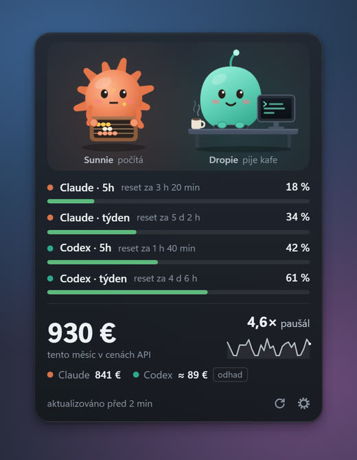
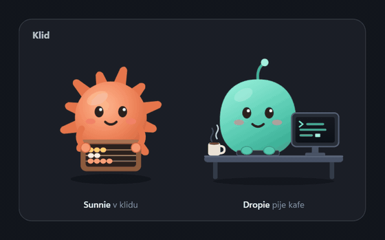
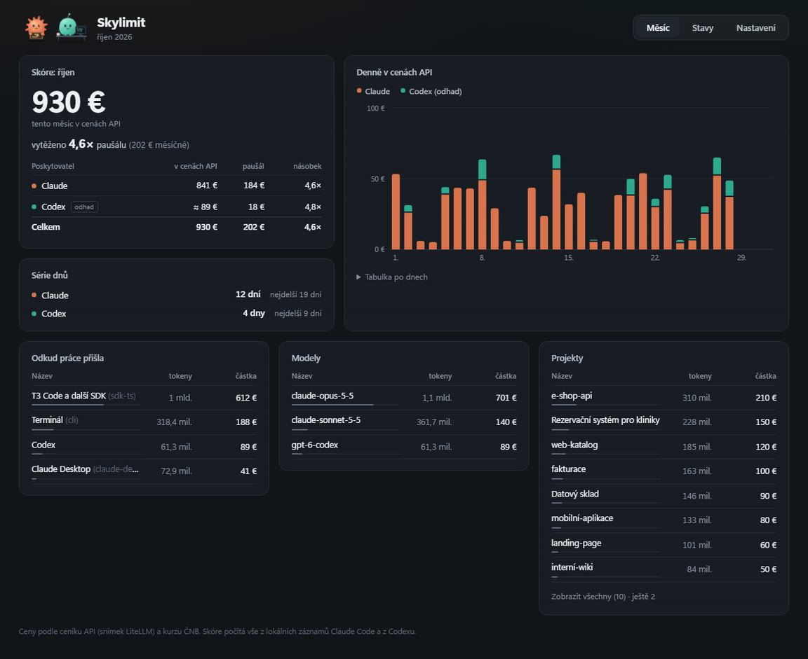

<div align="center">


# Skylimit

**Widget na plochu, který hlídá limity Claude a Codexu a počítá, kolik z předplatného vytěžíte.**

[](https://github.com/myspulin24/skylimit/releases/latest)
[](https://github.com/myspulin24/skylimit/actions/workflows/ci.yml)
[](LICENSE)
[](https://github.com/myspulin24/skylimit/releases/latest)

[Instalace](#instalace) · [Funkce](#funkce) · [Odkud čísla jsou](#odkud-čísla-jsou) · [Vývoj](#vývoj) · [Soukromí](#soukromí-a-oprávnění)

</div>

---

## Přehled

Skylimit je malý plovoucí widget a desktopová aplikace pro všechny, kdo
programují s **Claude Code** a **Codexem** na předplatné. Ukazuje, kolik zbývá
z pětihodinových a týdenních limitů, a přepočítává spotřebu na ceny API, takže
je hned vidět, kolikrát se předplatné vyplatí. Dvě postavičky, **Sunnie**
(Claude) a **Dropie** (Codex), dávají stav najevo náladou: když se blížíte
k limitu, začnou se potit, po milníku slaví a v noci spí.

<div align="center">

</div>

| | |
| --- | --- |
| **Platformy** | Windows 10/11, macOS 11+, Linux |
| **Data** | Jen lokální: záznamy a stavový řádek Claude Code, Codex CLI, logy T3 Code; historie v SQLite |
| **Technologie** | Tauri 2, Rust, React 19, TypeScript, SQLite |
| **Jazyk rozhraní** | čeština |
| **Licence** | MIT |

---

## Instalace

Stáhněte instalátor pro svůj systém ze [stránky vydání](https://github.com/myspulin24/skylimit/releases/latest).

| Systém | Soubor | Poznámka |
| --- | --- | --- |
| Windows | `Skylimit_<verze>_x64-setup.exe` | Instaluje se jen pro aktuálního uživatele, bez práv správce. |
| macOS | `Skylimit_<verze>_universal.dmg` | Univerzální balíček (Apple Silicon i Intel). |
| Linux | `Skylimit_<verze>_amd64.AppImage` | Spustitelné bez instalace (`chmod +x`). |
| Linux | `Skylimit_<verze>_amd64.deb` | Pro Debian, Ubuntu a odvozené. |

Instalátory nejsou podepsané komerčním certifikátem, takže je systém při
prvním spuštění zastaví:

- **Windows:** „Systém Windows ochránil počítač“ → **Další informace** →
  **Přesto spustit**.
- **macOS:** aplikace je podepsaná jen ad hoc. Poprvé ji otevřete pravým
  tlačítkem → **Otevřít**, nebo
  `xattr -dr com.apple.quarantine /Applications/Skylimit.app`.
- **Linux:** ikona v oznamovací oblasti potřebuje AppIndicator
  (`libayatana-appindicator3-1`); v GNOME rozšíření *AppIndicator Support*.

Od verze 0.6.0 se Skylimit **aktualizuje sám**: po spuštění a pak každých
6 hodin se podívá na GitHub Releases. Když najde novou verzi, ukáže ji tečka
na ozubeném kolečku ve widgetu a pruh v okně aplikace s tlačítkem
**Aktualizovat a restartovat**. Nic se nenainstaluje bez kliknutí. Balíček
se před instalací ověří podpisem proti klíči zabudovanému v aplikaci.
Historie i nastavení zůstanou. Na Linuxu se aktualizuje AppImage, balíček
`.deb` aktualizujte ze stránky vydání.

### Co Skylimit potřebuje

| Nástroj | K čemu | Bez něj |
| --- | --- | --- |
| [Claude Code](https://code.claude.com) | Skóre Claude ze záznamů v `~/.claude/projects`; limity Claude (i týdenní limit Fable) z jeho vlastní mezipaměti v `~/.claude.json`, po připojení i ze stavového řádku; přihlášený účet | Skóre Claude zůstane prázdné |
| [Codex CLI](https://github.com/openai/codex), přihlášený | Limity a spotřeba Codexu přes `codex app-server`. Na macOS a Linuxu si Skylimit cestu k němu zjistí z tvého shellu, i když běží z Docku nebo nabídky | Řádky Codexu ukážou „Codex CLI nenalezen“ |
| [T3 Code](https://github.com/pingdotgg/t3code) (volitelně) | Limity Claude z jeho logů | Bez T3 Code i bez připojeného Claude Code stojí místo limitů Claude „připoj Claude Code v Nastavení“ |

---

## Funkce

### Widget

Malé průhledné okno, vždy navrchu, mimo hlavní panel i Alt+Tab. Dá se
přetáhnout za scénu s postavičkami a pamatuje si, kde stálo.

- **Limity 5h a týden** pro Claude i Codex: procenta, odpočet do resetu
  a barva podle zaplnění (zelená, od 75 % oranžová, od 95 % červená).
  Pod týdenním limitem Claude je řádek **Claude · Fable**, pokud má účet na
  Fable vlastní týdenní limit.
- **Skóre v cenách API** s násobkem paušálu („vytěženo 4,6ד) a křivkou
  po dnech. Výchozí je tento měsíc; v **Nastavení › Widget** jde přepnout na
  posledních 24 hodin, 7, 30 nebo 90 dní nebo celou historii (násobek se
  přepočte na délku období) a na cenu **včetně úspory z cache**, tedy kolik
  by stejná práce stála v cenách API bez cache.
- **Obnovit** vedle ozubeného kolečka načte všechny zdroje hned, **bublina**
  otevře okno se zpětnou vazbou.
- **Průhlednost** (0–90 %) a **průchod kliknutí**, kdy widget nereaguje na myš.
- **Spouštění po přihlášení** (**Nastavení › Widget**, výchozí stav vypnuto):
  Skylimit se spustí sám, jakmile se přihlásíš do Windows, macOS nebo Linuxu.
  Na macOS musí běžet ze složky Aplikace.

### Nálady

<div align="center">

</div>

| Nálada | Kdy |
| --- | --- |
| Klid | Limity v pořádku, poslední práce před 5 až 30 minutami. |
| Soustředění | Nová spotřeba v posledních 5 minutách. |
| Oslava | Čtyři sekundy po milníku: násobek paušálu 1×, 2×, 3×, 5×, 10×, denní rekord, série 7, 14 a 30 dní. |
| Pot | Limit 5h nebo týdne je na 75 % a víc (uklidní se pod 70 %). |
| Panika | Limit je na 95 % a víc (uklidní se pod 90 %). |
| Dřímání | Číslo limitu je starší a čeká se na čerstvé. |
| Zmatek | Limity se nedaří zjistit, nebo se změnil formát záznamů Claude Code. |
| Spánek | 30 minut bez práce. |

Když platí víc nálad najednou, vyhraje ta výš v tabulce. Záložka **Stavy**
v aplikaci ukáže všechny s velkým animovaným náhledem.

### Okno aplikace

<div align="center">

</div>

- **Měsíc:** skóre a násobek paušálu po poskytovatelích, denní graf, série
  dnů a rozpad podle zdroje (terminál, T3 Code, Claude Desktop, Codex),
  modelu a projektu.
- **Historie:** spotřeba za 24 hodin, 7, 30 nebo 90 dní nebo za celou
  historii, v cenách API nebo v tokenech, pro oba nástroje nebo každý zvlášť.
  Graf po hodinách nebo dnech, součty (zpracované tokeny, z cache, bez cache,
  zápis do cache, výstup a úspora díky cache), cena podle typu tokenů a rozpad
  podle modelu, dne, zdroje a projektu.
- **Stavy:** všechny nálady, stavy řádků limitů, značky u skóre a barvy ikony.
- **Nastavení:** **Účty** (s jakým účtem Claude a Codexu je Skylimit
  spojený: e-mail, tarif, organizace nebo workspace, role, resety limitu),
  paušál a měna (EUR, CZK), co počítat do skóre, za jaké období a jakou
  cenu ukazuje widget, průhlednost widgetu, průchod kliknutí, smazání
  historie a **O aplikaci** (verze, licence).

Okno se přizpůsobí šířce: na velké obrazovce využije celou šířku (grafy se
roztáhnou, Nastavení a nálady ve Stavech jsou ve dvou sloupcích), na úzké
se karty složí pod sebe.
- **Zpětná vazba:** formulář pro chybu, změnu nebo vylepšení s volitelnou
  přílohou. Snímek obrazovky jde vložit rovnou ze schránky (⌘V, Ctrl+V).
  Viz [Soukromí](#soukromí-a-oprávnění).

Snímky v tomto README ukazují smyšlená demo data.

---

## Odkud čísla jsou

| Číslo | Zdroj | Jak často |
| --- | --- | --- |
| Limity Codexu | Oficiální `codex app-server` (JSON-RPC, `account/rateLimits/read`) | Každé 2 minuty a po každé změně |
| Spotřeba Codexu | `account/usage/read`: denní součty tokenů | Každých 5 minut |
| Limity Claude | Tři pasivní zdroje, platí novější číslo: limity, které si Claude Code sám načítá a ukládá do `~/.claude.json` (`cachedUsageUtilization`); `rate_limits`, které Claude Code předává svému [stavovému řádku](https://code.claude.com/docs/en/statusline) (po připojení v Nastavení); události `rate_limit_event`, které Claude Agent SDK předává T3 Code a ten je zapisuje do `~/.t3/userdata/logs/provider` | Mezipaměť Claude Code zhruba každých 10 minut, dokud Claude Code běží; ostatní po každé odpovědi. Kontrola každých 5 s |
| Limit Fable | Týdenní limit jen pro Fable z téže mezipaměti Claude Code (`weekly_scoped`) nebo z okna `seven_day_overage_included` v událostech T3 Code. Stárne jen prací s Fable | Stejně jako limity Claude |
| Účty | Claude: `oauthAccount` v `~/.claude.json`. Codex: `account/read` z `codex app-server` | Při otevřeném Nastavení každých 20 s |
| Skóre Claude | Záznamy Claude Code (`~/.claude/projects/**/*.jsonl`) × ceník API (snímek [LiteLLM](https://github.com/BerriAI/litellm)) | Hned po změně souboru |
| Starší historie Claude | Mezipaměť přehledu spotřeby T3 Code (`~/.t3/userdata/usage-scan-cache*.json`), jen pro záznamy, které Claude Code už smazal | Po prvním načtení a pak při změně, kontrola každých 10 minut |
| Kurz | Denní kurz [ČNB](https://www.cnb.cz) | Jednou denně |

Skóre Codexu je **odhad**: Codex vrací jen denní součty tokenů bez rozpadu
podle modelu, takže se násobí průměrnou sazbou. Ve widgetu je proto označené
značkou „odhad“ a dá se vypnout v nastavení.

**Starší historie z T3 Code:** Claude Code své záznamy po 30 dnech maže, takže
Skylimit po instalaci vidí jen poslední měsíc. T3 Code si ale čísla každé zprávy,
kterou kdy načetl, drží ve vlastní mezipaměti. Skylimit z ní vezme zprávy ze
smazaných záznamů. Nejdřív ověří, že čísla u zpráv, které zná sám, sedí, a podle
identifikátoru zprávy nic nezapočítá dvakrát. Obnovené zprávy mají zdroj
„Obnoveno z T3 Code“. Výstupní tokeny v nich můžou být nižší: T3 si u zprávy
pamatuje první, ještě neúplný údaj.

**Proč ne přímo z účtu Claude:** podmínky Anthropicu nedovolují aplikacím
třetích stran používat přihlašovací token Claude. Skylimit proto bere jen to,
co si Claude Code a T3 Code samy načtou a uloží. Claude Desktop limity nehlásí;
když se Claude po posledním hlášení použije tam, ukáže widget číslo s
vlnovkou jako „poslední známé“.

### Claude Code v terminálu

Limity Claude z Claude Code v iTermu2, Terminálu, Windows Terminalu nebo
terminálu v editoru se zapínají v **Nastavení › Claude Code v terminálu ›
Připojit**. Skylimit se tím stane [stavovým řádkem](https://code.claude.com/docs/en/statusline)
Claude Code: do `~/.claude/settings.json` zapíše jen klíč `statusLine` s
příkazem `skylimit statusline` a předtím si uschová kopii souboru. Claude
Code pak Skylimit spustí po každé odpovědi a předá mu procenta 5h a
týdenního limitu.

- Kdo už svůj stavový řádek má, o něj nepřijde: Skylimit ho spustí se stejným
  vstupem a ukáže jeho výstup. Jinak ukáže řádek `☀ Claude 5h 24 % · týden 41 %`.
- **Odpojit** vrátí původní `statusLine`. Před odinstalováním Skylimitu je
  dobré Claude Code odpojit, jinak stavový řádek zůstane prázdný.
- Limity Claude Code hlásí jen předplatitelům Pro a Max. Projekt s vlastním
  `statusLine` v `.claude/settings.json` má přednost a z něj limity nepřijdou.
- S vlastním stavovým řádkem Claude Code skrývá dole nápovědu klávesových
  zkratek (například `esc to interrupt`); tak to má Claude Code u každého
  stavového řádku.
- Na macOS musí Skylimit běžet ze složky Aplikace, jinak by se Claude Code
  odkazoval na dočasné umístění.

---

## Konfigurace

Všechno se nastavuje v aplikaci (**Nastavení**). Data leží mimo instalaci,
takže je odinstalace ani nová verze nesmaže:

| Systém | Složka |
| --- | --- |
| Windows | `%LOCALAPPDATA%\skylimit-data` |
| macOS | `~/Library/Application Support/skylimit-data` |
| Linux | `~/.local/share/skylimit-data` |

Uvnitř je `history.sqlite` (historie skóre a limitů), `settings.json`,
pozice oken a `diag/diag.log`. Diagnostický log obsahuje jen metadata, nikdy
text konverzací ani tajemství. Do verze 0.4.0 se složka jmenovala
`ai-usage-data`; novější verze ji při prvním spuštění sama přejmenuje.

| Proměnná prostředí | Účel |
| --- | --- |
| `SKYLIMIT_AUTO_UPDATE=0` | Vypne automatickou kontrolu aktualizací bez ohledu na nastavení (ruční kontrola v **O aplikaci** funguje dál) |
| `SKYLIMIT_FEEDBACK_URL` | Jiná adresa pro zpětnou vazbu, třeba místní `wrangler dev` (jen `https://`, nebo `http://` na `127.0.0.1`/`localhost`) |

---

## Vývoj

### Požadavky

- [Node.js](https://nodejs.org) 22.22 nebo novější
- [Rust](https://rustup.rs) stable
- Na Linuxu [systémové závislosti Tauri](https://tauri.app/start/prerequisites/)
  a `libayatana-appindicator3-dev`

### Spuštění

```bash
npm install
npm run tauri dev
```

| Příkaz | Popis |
| --- | --- |
| `npm run tauri dev` | Aplikace s jádrem v Rustu nad vašimi skutečnými daty |
| `npm run dev` | Jen rozhraní v prohlížeči nad ukázkovými daty (`?window=app`, `?mock=panic`, `?window=gallery`) |
| `npm test` | Celá testovací sada |
| `npm run package` | Sestavení vydání včetně instalátoru pro aktuální systém |

### Testy

```bash
npm test
```

| Část | Nástroj | Rozsah |
| --- | --- | --- |
| Rozhraní | `vitest` | Widget, okno aplikace, nastavení, zpětná vazba, formátování |
| Worker | `vitest` | Kontrola tvaru zprávy, issue, limity, chyby GitHubu |
| Jádro | `cargo test -p usage-core` | Ceny, skóre, nálady, čtení záznamů a logů, end-to-end proti podvrženému `codex app-server` |
| Shell | `cargo test -p skylimit` | Nastavení, ikona, odesílání zpětné vazby proti místnímu HTTP serveru |

### Architektura

```
src/                     Rozhraní (React): widget, okno aplikace, dialogy
crates/usage-core/       Jádro bez Tauri: zdroje dat, ceník, skóre, nálady, SQLite
  src/claude.rs            záznamy Claude Code (JSONL)
  src/codex.rs             codex app-server (JSON-RPC)
  src/claude_limits.rs     limity Claude: novější ze tří zdrojů, okno Fable zvlášť
  src/claude_config.rs     účet a mezipaměť limitů z ~/.claude.json Claude Code
  src/claude_code.rs       limity ze stavového řádku Claude Code
  src/t3.rs                limity z logů T3 Code
  src/t3_history.rs        starší historie z mezipaměti T3 Code
  src/history.rs           záložka Historie: období, typy tokenů, rozpady
src-tauri/               Shell: okna, ikona v oznamovací oblasti, příkazy, zpětná vazba
feedback/                Cloudflare Worker, který ze zpětné vazby zakládá issue
docs/snapshot-contract.md  Smlouva mezi jádrem a rozhraním
```

Jedno vlákno jádra vlastní databázi a z každé změny spočítá **snímek**
(`Snapshot`), který rozhraní jen vykresluje. Snímek nikdy neobsahuje tajemství
ani text konverzací. Rozhraní v prohlížeči (`npm run dev`) běží nad ukázkovými
daty se stejným tvarem snímku, takže jde ladit bez Rustu.

---

## Soukromí a oprávnění

Skylimit nemá účty, telemetrii ani analytiku. Sám od sebe navazuje dvě
spojení: jednou denně stáhne kurz ČNB a občas se podívá na GitHub, jestli
nevyšla nová verze. Codex CLI komunikuje s OpenAI sám, jako oficiální klient;
Skylimit jen čte, co vrátí.

Přihlašovací údaje se nečtou nikdy: ani `~/.claude/.credentials.json`, ani
`~/.codex/auth.json`. Z `~/.claude.json` Claude Code se čtou jen dva klíče,
`oauthAccount` (e-mail, jméno, organizace, tarif) a `cachedUsageUtilization`
(procenta limitů); zbytek souboru se přeskočí, aniž by se kamkoli uložil.
Účet Codexu (e-mail, tarif, workspace) vrací `codex app-server` na dotaz
`account/read`. Účty se ukazují jen v **Nastavení › Účty**, do widgetu ani
do zpětné vazby se nedostanou. Z logů T3 Code, ve kterých jsou celé
konverzace, se berou jen čísla limitů. Z mezipaměti přehledu spotřeby T3 Code
se berou jen čísla zpráv (čas, model, tokeny, identifikátor zprávy) a název
složky projektu; text konverzací v ní není. Ze vstupu stavového řádku Claude Code si Skylimit
nechá jen procenta limitů, čas resetu, identifikátor relace a počítadla, podle
kterých pozná novou odpověď. Pracovní složku, model ani cestu k přepisu
neukládá. Do `~/.claude/settings.json` zapisuje jen po kliknutí na
**Připojit** nebo **Odpojit** a jen klíč `statusLine`.

Spouštění po přihlášení zapisuje jen po zaškrtnutí a jen jeden vlastní záznam
s cestou ke Skylimitu do seznamu, který systém spouští po přihlášení:

| Systém | Záznam |
| --- | --- |
| Windows | Hodnota `Skylimit` v `HKCU\Software\Microsoft\Windows\CurrentVersion\Run`; odinstalátor ji smaže |
| macOS | `~/Library/LaunchAgents/cz.myspulin.skylimit.plist`; systém ho ukáže mezi položkami přihlášení |
| Linux | `~/.config/autostart/cz.myspulin.skylimit.desktop` |

Vypnout jde i přímo v systému. Vypnutí ve Správci úloh (Windows) nebo
v seznamu aplikací po spuštění (GNOME, KDE) Skylimit pozná. Před smazáním
aplikace na macOS nebo Linuxu je dobré spouštění vypnout.

| Funkce | Co odchází | Kdy |
| --- | --- | --- |
| Kurz ČNB | Dotaz na veřejnou stránku ČNB | Jednou denně |
| Kontrola aktualizací | Stažení `latest.json` z GitHub Releases | Po spuštění a každých 6 hodin; vypíná se v **Nastavení › O aplikaci** nebo `SKYLIMIT_AUTO_UPDATE=0` |
| Zpětná vazba | Napsaná zpráva, druh, záložka, verze a systém; volitelně jméno, e-mail a příloha | Po stisknutí **Odeslat** |

Zpětná vazba jde přes malý Worker na Cloudflare ([`feedback/`](feedback/)),
který z ní založí issue v soukromém repozitáři autora. Adresa je v aplikaci
pevná a webview ji změnit nemůže. Aplikace nenese žádný token; ten má jen
Worker. IP adresa se nikam neukládá.

Každé okno smí jen své příkazy (systémem vynucený seznam v
[`src-tauri/capabilities/`](src-tauri/capabilities/)):

| Okno | Smí |
| --- | --- |
| Widget | Číst snímek, otevřít okno aplikace, vyžádat obnovení dat, přetahovat se |
| Aplikace | Navíc měnit nastavení, průhlednost a průchod kliknutí, smazat historii, poslat zpětnou vazbu, připojit a odpojit Claude Code, zapnout a vypnout spouštění po přihlášení, ukázat přihlášené účty |

---

## Bezpečnost

Bezpečnostní chyby hlaste prosím
[soukromým hlášením](https://github.com/myspulin24/skylimit/security/advisories/new),
nikoli veřejným issue. Rozsah a postup popisuje [SECURITY.md](SECURITY.md).

---

## Přispívání

Chyby a náměty patří do [issues](https://github.com/myspulin24/skylimit/issues),
nebo rovnou do okna **Zpětná vazba** v aplikaci. Před odesláním pull requestu
spusťte `npm test`; stejnou sadu ověřuje CI.

Historie změn je v [CHANGELOG.md](CHANGELOG.md) ve formátu
[Keep a Changelog](https://keepachangelog.com/cs/1.1.0/). Text vydání se z něj
přebírá automaticky. Čísla verzí se řídí
[Semantic Versioning 2.0.0-rc.2](https://semver.org/spec/v2.0.0-rc.2.html);
co tvoří veřejné API a kdy se zvedá která část čísla, popisuje
[CHANGELOG.md › Verzování](CHANGELOG.md#verzování).

---

## Licence

MIT © 2026 Michal Jašek. Viz [LICENSE](LICENSE).
